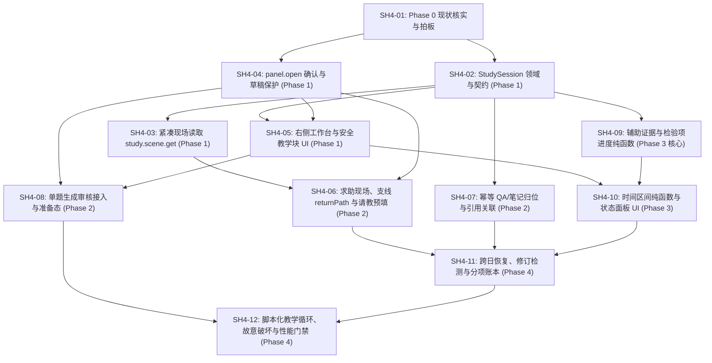

# StudyHub 4.0.0 开发计划与多 Agent 认领看板（Kanban）

> **架构基线**：[StudyHub 4.0.0 使用案例与分阶段规划架构书（设计稿 v2）](../../case-study/studyhub-4.0.0-use-case-study-zh-CN.md)
> **代码基线**：StudyHub 3.7.4（`StudyRuntime` 19 Contexts、内容寻址分片存储 `lib/store.js`、统一作业契约 `lib/jobs/`）
> **核心原则**：**教学上自由，数据上可靠，操作上简短。高内聚、低耦合、契约先行、测试守门。**

---

## 1. 文件导航（Agent 认领前必读）

| 文件 | 作用 | 何时阅读 |
|---|---|---|
| [`studyhub-4.0.0-use-case-study-zh-CN.md`](../../case-study/studyhub-4.0.0-use-case-study-zh-CN.md) | 4.0.0 架构书 v2：用例规格（UC-01 ~ UC-11）、8 条硬边界、默认策略转化表、分阶段退出条件 | 首次接手必读 |
| [`README.md`](README.md)（本文件） | Kanban 总看板、依赖拓扑、并行认领分组、文件所有权矩阵 | 认领 Issue 与更新状态时 |
| [`agent-rules.md`](agent-rules.md) | 认领规则、解耦与高内聚规范、性能红线、测试与回退守卫 | 每次编码与提 PR 前必读 |
| [`issues.md`](issues.md) | `SH4-01` ~ `SH4-12` 每个 Issue 的具体实现思路、接口签名、文件边界与验收标准 | 执行具体 Issue 时必读 |

---

## 2. Kanban 看板（状态追踪）

> 状态枚举：`TODO`（待认领） | `IN_PROGRESS`（进行中） | `IN_REVIEW`（待评审） | `BLOCKED`（受阻） | `DONE`（已合并）
> 认领方式：Agent 在独立 git worktree（分支命名 `codex/sh4-<编号>-<短横线主题>`）开工前，先登记「负责人 / 分支 / 基线 SHA」。

| Issue ID | GitHub | 阶段 | 标题 | 覆盖用例 | 前置依赖 | 可并行组 | 状态 | 负责人 / 分支 / PR / 验证 SHA |
|---|---|---|---|---|---|---|---|---|
| [`SH4-01`](issues.md#sh4-01) | [#534](https://github.com/EricWang1358/dsh-web-studyhub/issues/534) | Phase 0 | 宿主与现有链路核实、手动原型与 Phase 0 决策拍板 | 全用例基线 | 无 | Gate-0 | `DONE` | 主代理 / `main` / [`p0-baseline-audit.md`](p0-baseline-audit.md) + [`characterization.test.mjs`](../../../tests/guided-study-p0-characterization.test.mjs) |
| [`SH4-02`](issues.md#sh4-02) | [#535](https://github.com/EricWang1358/dsh-web-studyhub/issues/535) | Phase 1 | `StudySession` 纯领域模块、分片契约与 `guidedStudy4` 开关 | UC-01, UC-11 | `SH4-01` | Wave-1A | `DONE` | `main` / [`study-session.js`](../../../lib/study-session.js) + [`study-session.test.mjs`](../../../tests/study-session.test.mjs) |
| [`SH4-03`](issues.md#sh4-03) | [#536](https://github.com/EricWang1358/dsh-web-studyhub/issues/536) | Phase 1 | 有界紧凑现场读取 `study.scene.get` 与快照指纹复用 | UC-01, UC-04 | `SH4-02` | Wave-1B | `DONE` | `main` / [`study-scene.js`](../../../lib/study-scene.js) + [`study-scene.test.mjs`](../../../tests/study-scene.test.mjs) |
| [`SH4-04`](issues.md#sh4-04) | [#537](https://github.com/EricWang1358/dsh-web-studyhub/issues/537) | Phase 1 | `panel.open` 显示确认回执、过期请求防抢焦点与切题草稿持久化 | UC-03, UC-05, UC-10 | `SH4-01` | Wave-1A | `DONE` | `main` / [`panel-bridge.js`](../../../lib/panel-bridge.js) + [`panel-bridge-confirm.test.mjs`](../../../tests/panel-bridge-confirm.test.mjs) + [`review-draft-persistence.test.mjs`](../../../tests/review-draft-persistence.test.mjs) |
| [`SH4-05`](issues.md#sh4-05) | [#538](https://github.com/EricWang1358/dsh-web-studyhub/issues/538) | Phase 1 | 右侧带学工作台容器、安全富文本教学块与按动作自适应布局 | UC-01, UC-02, UC-10 | `SH4-02`, `SH4-04` | Wave-1B | `DONE` | `main` / [`ui/guided-study/`](../../../ui/guided-study/) + [`guided-study-workbench-ui.test.mjs`](../../../tests/guided-study-workbench-ui.test.mjs) |
| [`SH4-06`](issues.md#sh4-06) | [#539](https://github.com/EricWang1358/dsh-web-studyhub/issues/539) | Phase 2 | 作答后求助现场、有限返回栈 `returnPath` 与题卡「请教」预填 | UC-04, UC-05, UC-10 | `SH4-03`, `SH4-04` | Wave-2A | `DONE` | `main` / [`study-branch.js`](../../../lib/study-branch.js) + [`study-branch.test.mjs`](../../../tests/study-branch.test.mjs) + [`guided-study-ask-chat.test.mjs`](../../../tests/guided-study-ask-chat.test.mjs) |
| [`SH4-07`](issues.md#sh4-07) | [#540](https://github.com/EricWang1358/dsh-web-studyhub/issues/540) | Phase 2 | 幂等 QA/笔记归位、来源标注、题级—知识点级引用关联与版本保护 | UC-06 | `SH4-02` | Wave-2A | `DONE` | `main` / [`guided-qa.js`](../../../lib/guided-qa.js) + [`guided-qa.test.mjs`](../../../tests/guided-qa.test.mjs) |
| [`SH4-08`](issues.md#sh4-08) | [#541](https://github.com/EricWang1358/dsh-web-studyhub/issues/541) | Phase 2 | 小范围单题生成审核接入与右侧准备态/失败人话反馈 | UC-07, UC-10 | `SH4-04`, `SH4-05` | Wave-2A | `DONE` | `main` / [`guided-question-prep.js`](../../../lib/guided-question-prep.js) + [`guided-question-prep.test.mjs`](../../../tests/guided-question-prep.test.mjs) |
| [`SH4-09`](issues.md#sh4-09) | [#542](https://github.com/EricWang1358/dsh-web-studyhub/issues/542) | Phase 3 | 作答辅助证据记录（`assistance`）与检验项状态推导纯函数 | UC-08 | `SH4-02` | Wave-1B / Wave-2A | `DONE` | `main` / [`study-progress.js`](../../../lib/study-progress.js) + [`study-progress.test.mjs`](../../../tests/study-progress.test.mjs) |
| [`SH4-10`](issues.md#sh4-10) | [#543](https://github.com/EricWang1358/dsh-web-studyhub/issues/543) | Phase 3 | 剩余时间区间纯函数估算、预测变更记录与右侧状态/依据展开组件 | UC-08 | `SH4-05`, `SH4-09` | Wave-3A | `DONE` | `main` / [`study-time-estimate.js`](../../../lib/study-time-estimate.js) + [`study-time-estimate.test.mjs`](../../../tests/study-time-estimate.test.mjs) + [`StudyProgressPanel.jsx`](../../../ui/guided-study/StudyProgressPanel.jsx) |
| [`SH4-11`](issues.md#sh4-11) | [#544](https://github.com/EricWang1358/dsh-web-studyhub/issues/544) | Phase 4 | 次日/新会话继续、资料与题目修订差异检测、临时问答零副作用与分项成本账本 | UC-09, UC-10, UC-11 | `SH4-06`, `SH4-07`, `SH4-10` | Wave-4A | `DONE` | `main` / [`study-resume.js`](../../../lib/study-resume.js) + [`study-session-cost.js`](../../../lib/study-session-cost.js) + [`study-resume.test.mjs`](../../../tests/study-resume.test.mjs) + [`study-session-cost.test.mjs`](../../../tests/study-session-cost.test.mjs) |
| [`SH4-12`](issues.md#sh4-12) | [#545](https://github.com/EricWang1358/dsh-web-studyhub/issues/545) | Phase 4 | 假模型脚本化教学循环测试、故意破坏（Chaos）测试套件与性能预算守卫 | 全主路径门禁 | `SH4-08`, `SH4-11` | Gate-Release | `DONE` | `main` / [`guided-study-loop.test.mjs`](../../../tests/guided-study-loop.test.mjs) + [`guided-study-chaos.test.mjs`](../../../tests/guided-study-chaos.test.mjs) + [`perf-budget.test.mjs`](../../../tests/perf-budget.test.mjs) |

---

## 3. 依赖拓扑与多 Agent 并行认领路线图

### 并行波次说明（避免文件冲突）

1. **Gate-0（单 Agent）**：`SH4-01` 完成后锁定契约决策。
2. **Wave-1A（2 Agents 并行）**：
   - Agent A 认领 `SH4-02`（专注 `lib/study-session.js`、`lib/runtime/domain-contracts.js`、`lib/runtime-config.js`）；
   - Agent B 认领 `SH4-04`（专注 `lib/panel-bridge.js`、`lib/study-state.js` 草稿字段、`ui/host/workspace.jsx`）。
3. **Wave-1B（3 Agents 并行）**：
   - Agent A 认领 `SH4-03`（专注 `lib/study-scene.js`）；
   - Agent B 认领 `SH4-05`（专注 `ui/guided-study/` 新增独立目录与懒加载接入）；
   - Agent C 认领 `SH4-09`（专注 `lib/study-progress.js` 纯函数模块与单元测试，不碰 UI）。
4. **Wave-2A（3 Agents 并行）**：
   - Agent A 认领 `SH4-06`（专注 `lib/study-branch.js` 与 `ui/agent-prompts/guided-study.js`）；
   - Agent B 认领 `SH4-07`（专注 `lib/guided-qa.js` 与 `bank` / `materials` QA 幂等扩展）；
   - Agent C 认领 `SH4-08`（专注 `ui/guided-study/QuestionPrepSlot.jsx` 与单题生成作业状态绑定）。
5. **Wave-3A（1–2 Agents）**：`SH4-10`（专注 `lib/study-time-estimate.js` 与 `ui/guided-study/StudyProgressPanel.jsx`）。
6. **Wave-4A & Gate-Release**：`SH4-11` → `SH4-12` 收口验证。

---

## 4. 模块高内聚与文件所有权矩阵

为确保**高内聚、低耦合**且多 Agent 并行零冲突，4.0 新增能力严格拆分为**单一职责的纯函数模块（`lib/study-*.js`）**与**独立懒加载视图目录（`ui/guided-study/`）**，通过 `study.v1` 薄操作层装配：

| 新增/修改模块 | 唯一所属 Issue | 职责边界（高内聚） | 禁止耦合项（低耦合） |
|---|---|---|---|
| `lib/study-session.js` | `SH4-02` | `StudySession` 校验、状态转换、权限与范围校验、教学块引用管理 | 不读取题库全文、不执行 UI 逻辑、不调用模型 |
| `lib/study-scene.js` | `SH4-03` | 从只读视图 `view()` 构建有界紧凑现场（当前题、最近作答、范围、返回链） | 严禁 `structuredClone` 整库；不写任何状态 |
| `lib/panel-bridge.js` | `SH4-04` | `intentId`、过期检测、显示确认回执（`visible_in_sidebar` vs `queued_for_sidebar`） | 不直接读写 `store.js` 分片 |
| `lib/study-branch.js` | `SH4-06` | 支线压栈/出栈（`returnPath` 有界长度 ≤ 5）、切题前草稿保存协调 | 不重置原题 `attempts` 或 FSRS-6 调度 |
| `lib/guided-qa.js` | `SH4-07` | QA 幂等写入（`operationId`）、AI 来源标记、题级 QA 与知识点笔记引用绑定、引文轻量比对 | 不覆盖未授权用户手写块；不把 QA 设为出题事实源 |
| `lib/study-progress.js` | `SH4-09` | 检验项状态机纯函数（`待检验 / 借助提示完成 / 已独立通过 / 需复核`）、分子分母防突增 | 100% 纯函数，零 I/O，零模型调用，不改 FSRS-6 |
| `lib/study-time-estimate.js` | `SH4-10` | 有效学习用时过滤（剔除生成等待/暂停/纯阅读）、经验区间计算、目标变更预测记录 | 100% 纯函数，证据不足时诚实返回 `estimating` |
| `lib/study-resume.js` | `SH4-11` | 跨日/新会话恢复摘要、`source.revision` 与 `card.digest` 变更检测、分项成本汇总 | 不读取其他会话私有聊天历史 |
| `ui/guided-study/**` | `SH4-05/08/10` | 右侧工作台四区自适应布局、安全富文本教学块、单题准备态、进度依据展开 | 懒加载分块；不内联任意脚本；不自算成绩 |
