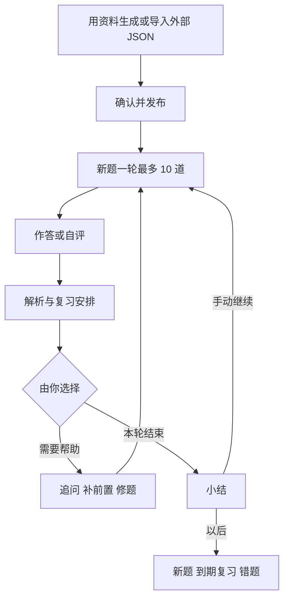

[English](study-workflows.md)

# 课程跟学、历史学习流与学习笔记

本文介绍 StudyHub 目前的课程学习、历史学习流只读归档与学习笔记：

- [按课程跟学](#按课程跟学)：从「学习库」首页按课程一批一批往下学，每门课拥有自己的「学法」（`course.method`）与可选的岗位 / 面试设置。
- [历史学习流记录（已退役，只读保留）](#历史学习流记录已退役只读保留)：学习流与自定义流程已退役，现由每门课的「学法」与主会话「AI 带学」（`study.session.*`）替代，此前的学习记录完整只读保留。
- [把题目写成公开笔记](#把题目写成公开笔记)：自己发到 CSDN 后，把文章链接关联回题目。

文末的[拟议：系统学习](#proposed-system-learning)是早期设计方案，尚未实现。

核对日期：2026-11-08，以当前代码为准。

## 按课程跟学

学习库会记住当前课程。首页标题就是课程名，点标题即可换课程。当前课程会一直保留到你主动切换；接着做别的课程的练习，也不会自动改变当前课程。

### 笔试 / 面试准备归入课程（`v4 → v5` 存储迁移）

笔试与口头面试准备现在就是一门普通课程，首页不再设全局「课堂跟学 / 笔试 / 面试」切换开关：

- 在任意课程的「课程设置」里，可以展开可选的「岗位与面试（可选）」，保存目标岗位方向和岗位说明（JD），并配合「重点知识点」与课程「学法」使用；口头面试与选择题笔试都按当前所选课程的范围和重点出题。
- 旧版学习库（`v4` 及更早）如果曾处于全局 `interview` 模式，或保存过非空的 `role`、`jd`、`targetTopics`，打开并在存储升级到 `v5` 时会自动且幂等地创建（或复用同名）课程（如 `笔试 / 面试 · <岗位>` 或 `笔试 / 面试`），把岗位方向、JD 和目标主题迁入该课程的 `interview` 设置、`focusTopics` 与「笔试 / 面试准备」学法；若原处于面试模式，`focus.course` 会指向这门课，全局 `focus.mode` 复位为 `'class'`。重复迁移不会重复建课，也不会丢失原有设置。

### 首页主卡给什么

首页主卡只给一个主按钮，按下表从上往下取第一条符合的：

| 情况 | 主卡给出 |
| --- | --- |
| 有做到一半的练习，也就是侧栏「回到题目」会打开的那一轮，不论属于哪门课 | 「接着做」。练习属于别的课程时，主卡标出课程名 |
| 课程的这一批还没做完 | 「接着学」 |
| 「今日学习」还没做完 | 「继续学习」 |
| 当前课程还有要学或要巩固的题 | 「继续课程」，开始下一批 |
| 以上都没有 | 「开始今日学习」；没有到期、薄弱或未学的题时改为「提前巩固」 |

属于「未激活」课程的半截练习不上主卡，只留在下方的未完成列表里。

其余入口收在「其他开始方式」里，随主卡内容不同，可能包括课程下一批、「到期复习与巩固」、为你定制的题和薄弱题。到期复习始终有自己的入口，与课程批次分开。当前阶段的扩展学习方式（如「讲给我听」AI 带学、「口头检验」、「整理笔记」）显示在首页课程进度下方的「学法」行与「课程设置」中。

其他没做完的练习收在「另有 N 组练习未完成」里；不属于当前课程的会标出课程名。点「结束」会结束这一轮，已答的记录保留。

### 按批学完一门课

课程里的每个题组算一章，章的顺序就是学习库里题组的顺序。每一批分两部分：

1. 先巩固这门课里学过、但现在薄弱或到期的题，最多 5 道。
2. 再按章的顺序学新题，最多 10 道；一章学完就接着进入下一章。

首页的课程进度条显示学到哪里。想按资料和章节找课程某一部分的题、只练这些题，点进度条下面的「总纲」（见[课程总纲](course-outline.zh-CN.md)）。要调整章的顺序，在题组的「⋯」菜单里打开「管理题组」，用「上移题组」「下移题组」。

主卡下方的「学习目录」列出当前课程，最新发布的题组在前。题组超过 3 个时只显示最近 3 个，点「查看全部题组」展开全部。点「查看其他课程」或搜索后，才会列出其他课程。

### 发布题组之后

在草稿里点「发布并开始练」，会立刻按题组顺序开始这个题组的一轮新题，最多 10 道。用资料生成的题组和导入的 JSON 题组都是这样。

一轮结束后，下一步由你来选。学完一轮新题，如果还有新题，可以点「继续下一批新题」再学 10 道。学完课程的一批，结果页会显示课程进度，并给出「继续课程下一批」。

除非你打开了「自动驾驶」（快捷键 A），否则不会自动开始下一步。自动驾驶详见[陪学说明](coach.zh-CN.md)。

### 导入 JSON 题组

在「创建题组 › 导入 JSON 题组」导入时，StudyHub 会建议一个短标题和所属课程。连接模型后，还可能建议发布时并入同一课程里的某个题组。每一项都由你确认或修改。原标题仍然保存，显示在「管理题组」页的「导入原标题」后。格式和提示词见[导入 JSON 题组](json-import.zh-CN.md)。

练习时：

- 导入的题会带「外部导入」标记。外部引用只有在原文片段唯一匹配学习库里的某份资料时才保留，StudyHub 不会伪造引用。
- 发布检查时标为「待核对」的题，照常可以练习。
- 缺少可判分内容的题会给出「跳过此题，不计成绩」。跳过不记录成绩，也不改变这道题的复习进度。模拟考试里不能跳过。

### 整理题组

- 在学习目录标题旁点「整理与添加 › 整理题组」，模型会针对当前课程的题组给出最多 8 条合并建议。只有你在某条建议上点「确认合并」后才会合并。没有可用模型时，可以在「管理题组」页手动合并。
- 合并后，每道题的 ID、作答记录、复习计划、前置关系和笔记关联都保留。历史学习流记录里的学习范围仍指向同样的题。历史学习流以外，包含被移动题目的未完成练习会结束，已答记录保留。
- 在「管理题组」页用「按主题拆分」，可以把所选主题的题移到同一课程下的新题组。拆分后两个题组都必须至少有一道题。
- 题组有正在编辑或修复的草稿时，不能合并或拆分。已归档的题组要先恢复。

## 历史学习流记录（已退役，只读保留）

「学习流」及最多 5 条自定义流程已退役：

- **替代方式**：每门课现在都有可编辑的「学法」（`course.method.*`），决定分几个阶段、过关宽严和当前阶段可用的辅助功能；需要边讲边练时，直接在主会话使用「AI 带学」（`study.session.*`）。原有的自定义流程直接退役，不提供流程编辑器，也不硬转成课程学法。
- **入口移除**：侧栏导航、功能导览和首页「其他开始方式 › 先讲后练 · 学习流」入口已移除。在「找功能」（`Ctrl/⌘ K`）搜索「学习流」会引导至「AI 带学」和「学法」。
- **历史记录完整只读保留**：老用户保存在 `workflowSessions` 里的学习流记录不会丢失：
  - 当学习库里存在历史学习流会话时，「学习统计」页面底部会显示「历史学习流记录 · 只读」，点「查看记录」即可打开当时的会话。
  - 待办看板或历史练习里带有 `studyRef`（`kind: 'workflow'`）的记录，仍能照常打开只读会话视图；视图顶部会平静说明学习流已由每门课的「学法」与主会话「AI 带学」替代。
  - 只读视图可以自由切换各个步骤，查阅当时保存的讲解材料、复述回答与 AI 反馈、关联的知识骨架、练习结果和步骤活动足迹，但不能新建、编辑、删除或继续推进步骤。
- **运行时接口边界**：只读查询（`workflow.list`、`workflow.session.get`、`workflow.context` 以及只读估算 `workflow.teaching.estimate`）继续保留以供查阅历史记录；所有写操作（`workflow.save`、`workflow.delete`、`workflow.quickstart`、`workflow.rescope`、`workflow.feedback`、`workflow.session.start`、`workflow.session.record`、`workflow.session.material`、`workflow.session.material.restore`、`workflow.session.advance`、`workflow.session.goto`、`workflow.session.status`、`workflow.session.delete`、`workflow.practice.start`、`workflow.teaching.start`、`workflow.teaching.undo`、`workflow.skeleton.generate`）均明确返回 `WORKFLOW_RETIRED`，引导改用 `course.method.*` 与 `study.session.*`。

## 把题目写成公开笔记

学习笔记是用你挑的题写成的一篇文章。文章由你自己发到 CSDN，之后 StudyHub 保存这篇文章的链接。

1. 打开「学习笔记」，点「挑题成文」。填「笔记标题」，搜索题目并勾选 1–30 道，点「创建笔记草稿」。练习时也可以在「更多」里选「写笔记」；这道题已经有笔记草稿时，会直接打开它，不会再建一份同名的。
2. 在「编辑 Markdown」里写正文。「实时预览」用 StudyHub 自带的库渲染公式，不需要联网下载。
3. 可选：点「AI 起草解析」在后台起草，完成后结果送到「信箱」，期间可以继续学习。模型收到每道题的题干、主题、学习目标、答案、解析、常见误区和你最近一次的作答结果。它被要求使用通用案例，不写 PPT、讲义、课程或个人信息。起草结果仍含 PPT、讲义或文件路径等线索时会被拒绝，需要你手动写公开版。
4. 在「CSDN 公开主页与文章链接」里填写 `https://blog.csdn.net/用户名` 格式的公开主页，点「保存主页」。这一步只需做一次。
5. 点「复制内容并打开 CSDN」。StudyHub 会先保存草稿，记下公开主页上已有哪些文章，然后复制 Markdown 并打开 CSDN 编辑器。在 CSDN 审阅并发布。
6. 回到 StudyHub，点「查找已发布文章」：
   - 如果第 5 步之后正好出现一篇同名新文章，会自动关联。
   - 如果有多篇候选、无法确认发布时间，或者只找到较早的同名文章，在候选里点「确认这篇文章」，或粘贴文章链接后点「手动关联」。链接必须属于已保存的公开主页。

关联后，学习库只保留标题、关联的题目、公开链接和时间，删除 Markdown 正文以及本机暂存的副本。已发布的笔记不能再修改，需要新建草稿。练习时，关联了笔记的题会显示「笔记草稿」或「已发布笔记」。

StudyHub 只保存你的公开主页地址，不要 CSDN 账号密码或 Cookie，也只读取公开主页。

## 当前学习循环与局限

目前的学习循环：

1. 得到一个题组：用资料生成，或导入外部 AI 根据资料写的 JSON。
2. 检查草稿，确认标题和课程，点「发布并开始练」。
3. 练最多 10 道新题，或按课程「学法」请主会话开始「AI 带学」。
4. 作答，或翻卡后自评。
5. 看解析，FSRS-6 安排下次复习。课程有将来的考试日期时，**考前对齐**（设置 › 导入、计划与备份 › 间隔复习 · FSRS-6，默认打开）让这次复习不晚于考试日，考试当天 0 点起就会出现。保存一门课的考试日期时，这门课已经排到考试之后的题会分散提前到考试前的几天，最容易忘的先回来，但不会早于你上次作答的后一天（今天答过的题最早明天出现；考试就在明天时，排到考试当天）；考试日期是这个版本之前填的，要在开关旁点「现在对齐」（课程的考试日期下会写还有几道题在等）。只改复习日期，记忆估计和掌握程度仍按 FSRS-6 算。删掉考试日期或关掉开关，原来的日期会回来。考试当天作答的题会排到考试之后。考试日过后，新的作答照常安排；提前了还没作答的题仍然到期，直到作答，或在设置里恢复原来的日期。不需要为考试调小「最长间隔」。
6. 需要时主动请求帮助、补前置题或修题。
7. 看本轮小结，再由你选择继续，或以后再复习。

目前的局限：

- 「今日学习」按到期、薄弱、新题的顺序排题（新题最多 10 道，总共最多 20 道），并把没学过的前置题排在需要它的题前面。所以它可能在你没要求时拉入前置题，这和“只在主动请求时补前置”的偏好不完全一致。下文拟议的系统学习不能直接沿用这个队列。
- 为你定制的题、逐步讲解、课程学法、AI 带学、口试和知识骨架都已经有了，但无论单独还是合起来，都没有对每个必学核心点做证据验收。

## 拟议：系统学习

本节全部是早期设计方案，没有实现；当前代码运行的仍是上文的课程跟学、课程「学法」和主会话带学流程。

规则和开发拆分以[统一开发计划](plans/2026-09-27-1945-feat-evidence-based-learning-plan.md)为准，交接时的状态见[本次 handoff](handoffs/2026-09-27-learning-workflow-redesign.md)。

**适用对象**：接近零基础、已用五份 Platform Engineering PDF 生成五个题组的学习者。这些资料的真实内容尚未核查，下面是产品流程设计，不是已经成立的课程覆盖报告。首版实操由用户选定为外部完成：学习者在自己的环境里完成并提交成果，插件不内置执行环境。

### 入口与模式

- 按课程学习保留。学习者主动选择“系统学习”后，只需确定课程范围、起点和目标；目标默认采用已知的“接近零基础、理解并能应用”。已经确认的信息不再重复询问。
- 主按钮为“继续系统学习”，旁边一句理由，例如“先弄清请求如何到达服务，后面的发布排错会用到”。
- 题目发布后即可学习。只有 JSON 时显示“题组已就绪，资料覆盖待核对”；关联原始 PDF 后才在后台做范围审计。不需要逐题审完才能开始。
- 每轮最多 5 个学习任务，一次实操可以独占一轮。课堂原有的 10 道新题规则继续保留。下一轮必须由学习者手动开始。
- 已在系统学习模式时，发布后回到系统任务或入门入口，不再自动开启课堂的 10 题一轮。

### 八个步骤

| 步骤 | 学习者看到和操作什么 | 系统在后台做什么 | 过关与失败返回 |
| --- | --- | --- | --- |
| 1. 确定范围 | 看简短的课程目标与“哪些资料待核对”；必要时补原始 PDF | 分段提取目标、跨资料归并、匹配题目，标出图表不确定性和缺任务的点 | 没有资料也能学；只称候选范围，不宣称覆盖全部核心 |
| 2. 最小前置诊断 | 用几个小检查确认当前台阶，允许“不知道”和“稍后” | 区分未诊断、基础缺口与环境阻塞，给出最小补救包 | 用户点“先补基础”才进入；补完回原位置；跳过仍显示缺口 |
| 3. 看整体案例 | 先看一个能理解的过程，再看少量概念与关系 | 把五个题组映射到同一条课程主线；没有题的概念仍显示 | 能用自己的话说清要解决的问题；说不清则回到相应前置 |
| 4. 理解一个单元 | 看示范、补步骤、解释原因，再独立做 | 按表现逐步减少提示，保存阶段和帮助使用记录 | 必需评分项通过才推进对应维度；讲解完成不等于学会 |
| 5. 回忆并保持 | 合上答案说出或写出；距该知识点最近一次学习至少 24 小时后复测 | 跨题记录相关讲解、提示和练习的时间，FSRS-6 继续管卡片 | 刚重讲后换题答对只算当前表现；延迟复测失败回到相应薄弱点 |
| 6. 迁移与辨析 | 面对变约束、反例、排错或跨章节问题，先回答再看反馈 | 检查任务族、未展示状态和评分标准，避免只是换词 | 通过陌生任务才记相应迁移证据；只会原题则继续练新情境 |
| 7. 外部小实验 | 读目标、环境和验收项，在自己的环境完成后提交成果 | 校验提交是否完整，按标准审阅并给出最少补交项 | 标明“提交物审阅通过”等实际证据级别；环境失败不当作概念不懂 |
| 8. 综合与延迟验收 | 看每个核心点还缺什么，下一轮只选一个具体任务 | 汇总逐点各维度，处理到期复测、较新的失败和范围版本变化 | 全部必学点都有有效证据才称本范围已验收；任何缺项都不能被高平均分抵消 |

第 4–7 步按单元循环，期间穿插局部骨架回忆；第 5、8 步跨日继续。八步不对应八个必须逐一打开的页面，也不对应五份 PDF 的线性顺序。

### 现在与拟议对比

| 方面 | 现在 | 拟议 | 迁移方式 |
| --- | --- | --- | --- |
| 学习主线 | 按题组、主题及卡片顺序，课堂最新内容优先 | 按目标、前置和证据缺口推进 | 新路线可选，课堂逻辑保留 |
| 范围 | 从已有题目看主题和骨架 | 原资料单独建台账，遗漏的核心点也可见 | 已有题目关联到新的知识点 ID，不强制重新生成 |
| 首次理解 | 常从做题和答后解析开始 | 示例 → 半完成 → 独立检查 | 复用现有讲解和题卡组件 |
| 前置不会 | 卡住后追问或关联，部分路径自动拉题 | 最小诊断、明确的补救入口、限量、回到原位 | 不直接复用会自动拉前置的路径队列 |
| 掌握状态 | 按最近表现和 FSRS-6 间隔推算，主题按加权值汇总 | 理解、回忆、迁移和实操按目标分别验收 | 旧统计称为估计熟练度，历史不清零 |
| 举一反三 | 定制变式、按题干关键词分类、口头追问 | 未见过的任务族、变约束、说明理由并有评分依据 | 原变式继续用于练习，新任务才有独立验收资格 |
| 记住骨架 | 浏览结构和顺序，从节点练题 | 阅读之外加入遮挡节点、补关系、排序和故障推演 | 复用画布，验收状态单独记录 |
| 实际应用 | 以题目和讨论为主 | 外部实验、提交成果、逐项审阅、可重交 | 不增加执行器，不声称观察到了外部运行 |
| 完成标准 | 一轮结束、题目熟练度、抽样考试成绩 | 当前范围每个必学点都有所需的全部有效证据 | 原有考试保留；抽样高分不等于全覆盖 |
| 使用负担 | 自己在题组、骨架、追问和考试之间切换 | 一个当前任务、一句原因，缺口可展开查看 | 不再增加一排必须使用的新按钮 |

### 日常使用

- 进入后先恢复未完成的任务。没有未完成任务时，推荐一个到期的核心复测、当前阻塞点或新单元，用户可以更换。
- 任务中只显示当前问题和主操作，解释和帮助按需展开。
- 补前置计入本轮预算，不无限递归：默认最多 3 个局部台阶，再深就建议单独学一个基础单元。
- 轮末显示“本轮新增了什么证据、哪个核心点还缺什么、下次做哪件事”。浏览骨架或生成笔记都不算验收。
- 未学和未评估的内容不涂成红色失败；模型评分处理中、环境阻塞和真正答错分别显示。关闭页面后回来，继续原来的任务。

### Platform Engineering 示例

以下任务只示范结构，实际知识范围要等五份资料核对后确定。

1. 先用提供的示例服务认识“请求、进程、端口和日志”，能预测一次请求会走到哪里。
2. 看一次交付示范，补全遗漏的测试和发布步骤，再解释失败时应该查看什么证据。
3. 改变配置或访问条件，先预测结果，再在外部环境验证，报告预测与观察是否一致。
4. 把流程整理成另一位开发者可以重复使用的模板，说明默认值、可配置项、限制和使用者收益。
5. 隔天凭记忆画出简化链路，面对一个新故障指出排查顺序，并提交修订后的成果。

“会运行示例”只覆盖其中一部分目标；“会解释限制并能在变更条件下验证”需要额外证据。

### 进度与证据

- 首页示例文案：“当前范围 12/18 个核心点已验收；4 个待独立检查，2 个待实操。资料范围仍有 1 页图表待核对。”这些数字是示例，不是真实用户数据。
- 点开一个核心点，能看到所需维度、通过和缺失的依据、是否用过帮助、最近一次验证以及来源版本。
- 同一个实验可以支撑多个核心点，但各点分别评分。口头回答、骨架任务和普通题目都不会自动推断所有前置已经掌握。
- 具体的证据门槛、分母规则、失效与迁移，由计划中的 Evidence Policy 和 R2–R15 定义。

### 异常与恢复

| 场景 | 用户看到什么 | 恢复方式 |
| --- | --- | --- |
| 缺 PDF，或扫描图没有识别出来 | 范围待核对，以及现在能继续学的内容 | 稍后在后台补审计，不阻塞已有题目 |
| 模型失败或评分不完整 | 提交已保存，暂未评估 | 重试同一份提交，或换一个已有任务；不会自动记为失败 |
| 资料或目标更新 | 哪些核心点是新增的，哪些需要重新验证 | 当前会话保留版本快照，显式切换或从下一轮起采用新范围；旧任务结果只计入旧版本，已撤销的任务保留回答并转到新入口 |
| 补前置越来越深 | 本轮预算和可以返回的入口 | 暂停补救，推荐单独的基础单元，不强行递归 |
| 实验环境跑不起来 | 环境阻塞和最少的诊断项 | 保留进度，区分环境问题和知识错误 |
| 重复提交或反馈迟到 | 唯一的提交记录及对应版本 | 过期结果不覆盖新提交，得分不重复增加 |
| 斩题、题组合并或拆分 | 知识点和历史保留，必要时显示缺少的评估任务 | 不暗中减少必学分母，不因整理题组丢失进度 |

### 交付边界

八步系统学习尚未交付。计划把开发分为三个阶段：

- P0：覆盖与可信进度；
- P1：零基础学习循环；
- P2：外部实操与综合验收。

实施单元 U1–U9、验收示例 AE1–AE16 和测试文件都列在计划里。

## 开发者参考：代码边界

- `lib/focus.js` 负责当前课程和新题排序；`lib/course-route.js` 负责分章和课程批次；`lib/course-method.js` 定义每门课的「学法」。
- `lib/store.js`（`LATEST_VERSION = 5`）将旧版全局面试焦点设置（`mode: 'interview'`、`role`、`jd`、`targetTopics`）幂等迁移为课程记录（`interview`、`focusTopics`、`method`）。
- `lib/deck-organization.js` 负责题组的合并、拆分和排序，并迁移所有指向被移动题目的引用。`lib/deck-merge-suggestions.js` 校验模型给出的合并建议，建议本身不会直接改动学习库。
- `lib/blog-notes.js` 负责笔记状态与题目关联；`lib/adapters/csdn-public.js` 只读取 CSDN 公开网页。
- `lib/workflows.js` 和 `lib/contexts/workflows/operations.js` 保留历史学习流记录的只读查阅，并以 `WORKFLOW_RETIRED` 拒绝已退役的写操作。
- 业务操作位于 `lib/contexts/<domain>/operations.js`，掌握持久化和规则；`lib/service.js` 只是兼容门面，见[架构说明](architecture.md)。`ui/` 只展示状态和收集确认，不决定合并、判分或链接安全。
- 上述首页规则依据[用户反馈记录](user-feedback-intake.md)中的决策 F-006、F-023。
